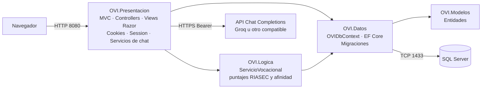
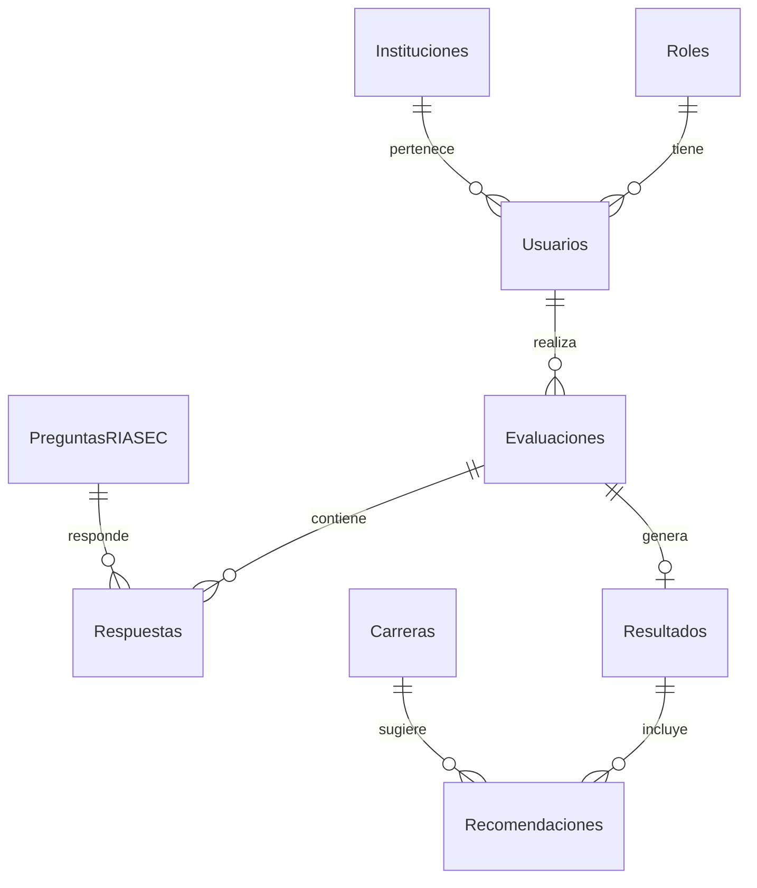

# Manual técnico

## 1. Arquitectura del sistema

Aplicación monolítica modular en **cuatro capas** (solución `OrientacionVocacional.slnx`, .NET 8):



| Proyecto | Responsabilidad |
|---|---|
| `OVI.Presentacion` | Controladores MVC, vistas Razor, autenticación por cookies, sesión, *health check*, servicios de chat (FAQ e IA), inicialización del administrador |
| `OVI.Logica` | `ServicioVocacional`: valida respuestas, calcula puntajes RIASEC, perfil dominante y afinidad de carreras |
| `OVI.Datos` | `OVIDbContext`, relaciones, datos semilla y migraciones de EF Core |
| `OVI.Modelos` | Entidades con restricciones (*Data Annotations*) |

Flujo principal: *Estudiante responde el test → `TestController` → `ServicioVocacional.CalcularAsync` → guarda `Evaluacion`, `Respuestas`, `Resultado`, `Recomendaciones` con EF Core → redirige a la vista del resultado → el Asistente lee ese resultado de la BD para construir el contexto de IA.*

## 2. Tecnologías utilizadas

| Capa | Tecnología |
|---|---|
| Backend / Frontend | C# · ASP.NET Core MVC (.NET 8) · Razor · Bootstrap 5.3.3 (CDN) · JavaScript (chat, test paso a paso) · fuentes Raleway/Roboto |
| Acceso a datos | Entity Framework Core 8.0.11 (*code first*, migraciones) |
| Base de datos | SQL Server (Express local; SQL Server 2022 Express en Docker) |
| Seguridad | Cookies de autenticación, `IPasswordHasher<Usuario>`, antiforgery, autorización por roles (Estudiante y Admin) |
| IA | API REST *Chat Completions* (Groq, modelo `openai/gpt-oss-20b` por defecto) consumida con `HttpClient` |
| Contenedores | Docker (Dockerfile multietapa) y Docker Compose |
| CI/CD y nube | GitHub Actions → Azure App Service (workflow incluido); propuesta completa en `PROPUESTA_AZURE.md` |

## 3. Estructura del proyecto

```
OVI-Orientacion-Vocacional/
├── OrientacionVocacional.slnx
├── docker-compose.yml · .env.example · .dockerignore · .gitignore
├── .github/workflows/main_ovi-orientacion-vocacional.yml   CI/CD a Azure App Service
├── docker/Dockerfile
├── database/                     01_crear_base.sql (auxiliar) y README
├── docs/                         manuales, pruebas, avance técnico, guion del pitch, evidencias/, capturas/
└── src/
    ├── OVI.Modelos/Entidades/Entidades.cs
    ├── OVI.Datos/                OVIDbContext.cs · Migraciones/
    ├── OVI.Logica/Servicios/ServicioVocacional.cs
    └── OVI.Presentacion/
        ├── Program.cs · appsettings.json
        ├── Controllers/          Home, Cuenta, Test, Chatbot, Dashboard, Usuarios, Preguntas, Carreras, Instituciones
        ├── Models/               CuentaVM, AdminVM, ChatbotModelos
        ├── Servicios/            ChatbotFAQService, ChatbotIAService, ChatbotIAOptions, AdminInicializador, UsuarioActual
        ├── Views/                una carpeta por controlador + Shared (_Layout)
        └── wwwroot/              css (site, chatbot, faq-widget), js (chatbot, faq-widget), img (Saviox)
```

### Rutas y permisos

| Ruta | Acceso |
|---|---|
| `/`, `/Cuenta/Registro`, `/Cuenta/Login` | Público |
| `/Chatbot/Faq`, `/Chatbot/FaqOpciones`, `POST /Chatbot/PreguntarFaq` | Público (no disponible para Admin) |
| `/Test`, `/Test/Resultado/{id}`, `/Test/Historial` | Estudiante (el resultado solo lo ve su dueño) |
| `/Chatbot/Contextual`, `POST /Chatbot/PreguntarIA` | Estudiante (con sesión) |
| `/Dashboard` | Admin |
| `/Usuarios`, `/Preguntas`, `/Carreras`, `/Instituciones` (Crear, Editar, Estado) | Admin |
| `/health` | Público (*health check*) |

## 4. Modelo de datos



Tablas: `Roles`, `Instituciones`, `Usuarios` (`PasswordHash`, `Estado`), `Evaluaciones`, `PreguntasRIASEC`, `Respuestas`, `Resultados` (puntajes R, I, A, S, E, C y `PerfilDominante` nvarchar(255)), `Carreras` (incluye `AreasRIASEC`), `Recomendaciones` (`NivelAfinidad` decimal(5,2), `Posicion`) y `FAQChatbot`. Índices únicos: `Roles.Nombre`, `Usuarios.Correo`, `Resultados.IdEvaluacion`. Eliminaciones en cascada solo para `Respuestas` y `Recomendaciones`; el resto usa `Restrict`.

**Migraciones** (`src/OVI.Datos/Migraciones`, fuente de verdad del esquema): `Inicial` → `AmpliarPerfilDominante` (10 → 255 caracteres) → `AgregarAreasCarrera` (`Carreras.AreasRIASEC`, NULL en las carreras sembradas, que conservan la regla por nombre) → `EliminarRolOrientador` (quita el rol opcional; si algún usuario lo tenía pasa a Estudiante). **Semillas:** 2 roles (Estudiante, Admin), 1 institución, usuario demo sin contraseña, 12 preguntas RIASEC (2 por área), 8 carreras y 3 FAQ.

**Lógica de negocio (`ServicioVocacional`).** Exige que las respuestas coincidan exactamente con las preguntas activas, sin duplicados y con valores 1–5. Puntaje por área = suma de las respuestas de esa área. Perfil dominante = áreas con puntaje máximo (unidas con `-`). Afinidad de una carrera = suma de los puntajes del estudiante en las áreas de la carrera ÷ (n.º de áreas × puntaje máximo obtenido), con tope 100 %; se guardan las 3 mejores. Las áreas salen de `Carrera.AreasRIASEC` (carreras creadas en el panel) o, si es NULL, de una regla por nombre para las 8 carreras sembradas.

## 5. Configuraciones realizadas

- **`Program.cs`:** MVC, `DbContext` SQL Server con la cadena `OVIConnection`, `ServicioVocacional` y `IPasswordHasher`, `HttpClient` tipado para la IA, `Session` (30 min, HttpOnly), autenticación por cookies (8 h, HttpOnly, SameSite Lax, ruta de login y de acceso denegado), `AddHealthChecks` → `/health`, manejador de excepciones (`/Home/Error`) y HSTS fuera de desarrollo.
- **Revalidación de sesión:** en cada petición `OnValidatePrincipal` consulta al usuario; si fue desactivado o cambió de rol, la cookie se rechaza.
- **Migraciones automáticas:** solo si `OVI_APPLY_MIGRATIONS=true` (Docker/Azure), con hasta 12 reintentos cada 5 s esperando a la base.
- **Administrador inicial:** `AdminInicializador` crea un admin nuevo con `OVI_ADMIN_EMAIL` y `OVI_ADMIN_PASSWORD` (≥ 12 caracteres); nunca eleva una cuenta existente.
- **Seguridad:** contraseñas con hash, `[ValidateAntiForgeryToken]` en todos los POST (también en los AJAX del chat mediante la cabecera `RequestVerificationToken`), `[Authorize(Roles=...)]`, comprobación de propietario en resultados, registro público solo como Estudiante, baja lógica en lugar de borrado, validaciones con *Data Annotations* y en el servidor.
- **Manejo de excepciones:** errores de validación del test se muestran en el formulario; el servicio de IA captura timeouts, errores de red/HTTP y de JSON y devuelve mensajes genéricos (el detalle va al log).

## 6. Integración de Inteligencia Artificial

**Funcionalidad:** *Asistente vocacional "Saviox"* — chatbot generativo que conversa sobre el último resultado del estudiante. El chat de **FAQ** es independiente y **no** usa IA (palabras clave sin tildes ni *stopwords* sobre la tabla `FAQChatbot` y un banco base).

| Aspecto | Detalle |
|---|---|
| **Datos de entrada** | Pregunta del usuario (≤ 500 caracteres); desde la BD: `PerfilDominante` y las 3 `Recomendaciones` (carrera y % de afinidad) del último `Resultado`; hasta 6 turnos previos guardados en `Session` por usuario y resultado |
| **Procesamiento** | `ChatbotController.PreguntarIA` obtiene el contexto → `ChatbotIAService` construye un *system prompt* (rol de asesor, datos calculados que no debe contradecir, reglas: solo orientación vocacional, no inventar carreras, no garantizar admisión/empleo, sin diagnósticos, 4–5 líneas) + historial + pregunta → `POST` JSON `{model, messages, temperature 0.5, max_tokens 400}` con `Authorization: Bearer <ApiKey>` al endpoint HTTPS configurado; *timeout* de 18 s |
| **Resultados** | Texto en español de `choices[0].message.content`, mostrado en la vista; el turno se agrega al historial (máx. 6) |
| **Casos controlados** | Sin resultado previo → pide hacer el test; sin configuración (clave, modelo, endpoint HTTPS) → avisa que la IA no está configurada y **no** llama al proveedor; error/timeout → mensaje genérico |
| **Beneficio** | Convierte el resultado numérico del test en orientación personalizada y conversacional (por qué encaja una carrera, qué habilidades necesita, cómo compararlas) sin que el estudiante deba interpretar los puntajes solo |
| **Configuración** | Sección `ChatbotIA` (`Endpoint`, `Modelo`, `ApiKey`); variables `ChatbotIA__*` (Docker: `IA_*`). La clave nunca se versiona |

Las recomendaciones de carrera las calcula el sistema con reglas determinísticas; la IA solo las **explica**, no las genera.

## 7. Configuración Docker

**`docker/Dockerfile`** (multietapa): imagen `dotnet/sdk:8.0` restaura y publica `OVI.Presentacion` en Release; imagen final `dotnet/aspnet:8.0`, `ASPNETCORE_URLS=http://+:8080`, `EXPOSE 8080`, ejecuta como usuario no root (`USER $APP_UID`).

**`docker-compose.yml`**

| Servicio | Detalle |
|---|---|
| `db` | `mcr.microsoft.com/mssql/server:2022-latest`, `MSSQL_PID=Express`, `ACCEPT_EULA=Y`, contraseña `MSSQL_SA_PASSWORD` (obligatoria), volumen `ovi_sql_data:/var/opt/mssql`, *healthcheck* TCP al puerto 1433, `restart: unless-stopped` |
| `web` | Construye con `docker/Dockerfile`, publica `8080:8080`, `depends_on: db (service_healthy)`, variables: `ConnectionStrings__OVIConnection` (servidor `db`), `OVI_APPLY_MIGRATIONS=true`, `ChatbotIA__*` ← `IA_*`, `OVI_ADMIN_*`, `ASPNETCORE_ENVIRONMENT=Production` |

`.env.example` documenta todas las variables; `.env` está excluido de Git y de la imagen (`.dockerignore`).

## 8. Despliegue en la nube

Propuesta en [PROPUESTA_AZURE.md](PROPUESTA_AZURE.md). Existe un workflow de GitHub Actions (`main_ovi-orientacion-vocacional.yml`) que compila con .NET 8 (`dotnet publish`) y despliega a Azure App Service con inicio de sesión OIDC.

## 9. Operación y limitaciones

- Cookies y sesión no persisten entre reinicios de contenedor sin configurar un *key ring* compartido de Data Protection; la sesión (historial del chat) usa memoria del proceso.
- El contenedor sirve HTTP; para HTTPS usar un proxy inverso (en Azure lo provee App Service).
- Producción real requeriría recuperación de contraseña, bloqueo por intentos, confirmación de correo, auditoría, gestión de secretos (Key Vault), copias de seguridad y pruebas automatizadas.
- Las recomendaciones RIASEC son heurísticas orientativas, no psicometría validada.
