# Manual de usuario

OVI (VocalO) ayuda a estudiantes a explorar sus intereses con el modelo **RIASEC** y a conocer carreras afines. Los resultados son **orientativos**; no son un diagnóstico ni deciden por ti.

> Las capturas de este manual están en `docs/capturas/`.

## 1. Acceso al sistema

1. Abre la dirección de la aplicación (en Docker: `http://localhost:8080`).
2. **Crear cuenta** (esquina superior): escribe nombre, apellido, correo y una contraseña de **al menos 8 caracteres**, y confírmala. Si el correo ya existe, el sistema lo avisa. Las cuentas nuevas son siempre de **Estudiante**.
3. **Ingresar**: correo y contraseña. Con datos incorrectos aparece "Correo o contraseña incorrectos". Una cuenta desactivada por el administrador no puede entrar.
4. **Salir**: botón en la barra superior (muestra tu nombre). La sesión también expira tras 8 horas.

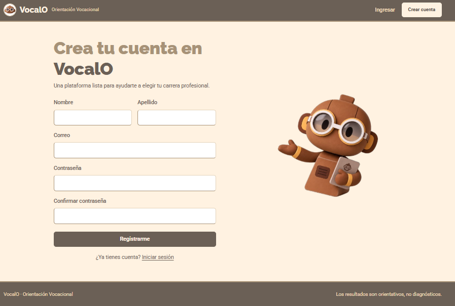
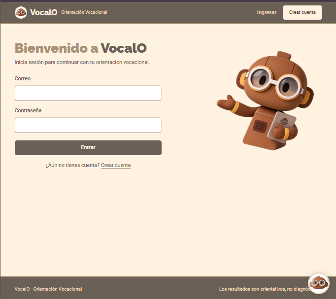

Hay dos roles, **Estudiante** y **Administrador**, y el menú cambia según el tuyo. Si intentas abrir una página para la que no tienes permiso verás "Acceso denegado".

## 2. Visitante (sin sesión)

- Ve la página de inicio con la presentación de OVI.
- Puede registrarse, iniciar sesión y usar la burbuja de **Preguntas frecuentes** de Saviox (abajo a la derecha).
- Para hacer el test o usar el Asistente con IA debe iniciar sesión.

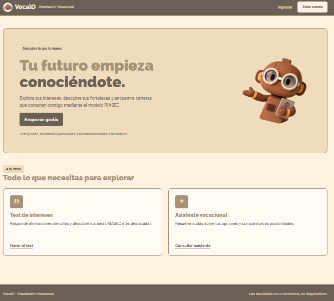

## 3. Estudiante

**Inicio.** Muestra cuántas evaluaciones has finalizado y tu último perfil RIASEC, con acceso rápido al test y al Asistente.

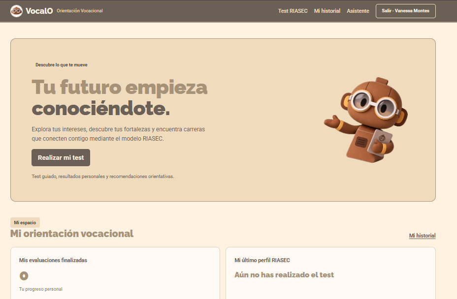

### 3.1 Test RIASEC
1. Menú **Test RIASEC**. Lee la introducción y pulsa **Iniciar el test**.
2. Se muestra **una afirmación por pantalla** (12 en total) con una barra de progreso. Elige de 1 (*Nada*) a 5 (*Muchísimo*) cuánto te identifica y avanza con **Siguiente** (o vuelve con **Anterior**).
3. Debes responder todas las preguntas. Al final pulsa para enviar; el sistema calcula tu perfil.

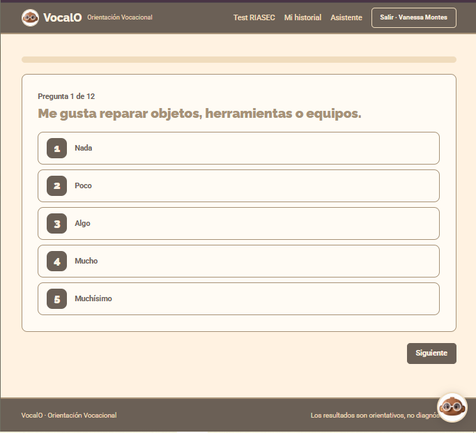

### 3.2 Resultado
Verás tu **perfil dominante** (las áreas con mayor puntaje; puede haber empates, p. ej. "Investigador-Convencional"), el puntaje en cada área (R, I, A, S, E, C) y las **3 carreras con mayor afinidad** (porcentaje). Usa **Imprimir / Guardar PDF** para conservarlo. Solo tú puedes ver tus resultados.

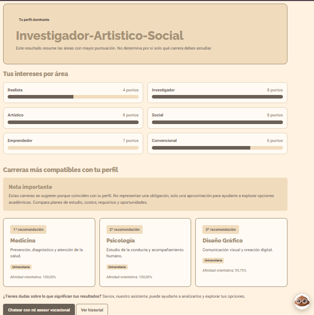

### 3.3 Historial
**Mi historial** lista tus evaluaciones anteriores; puedes repetir el test cuantas veces quieras y cada intento queda guardado.

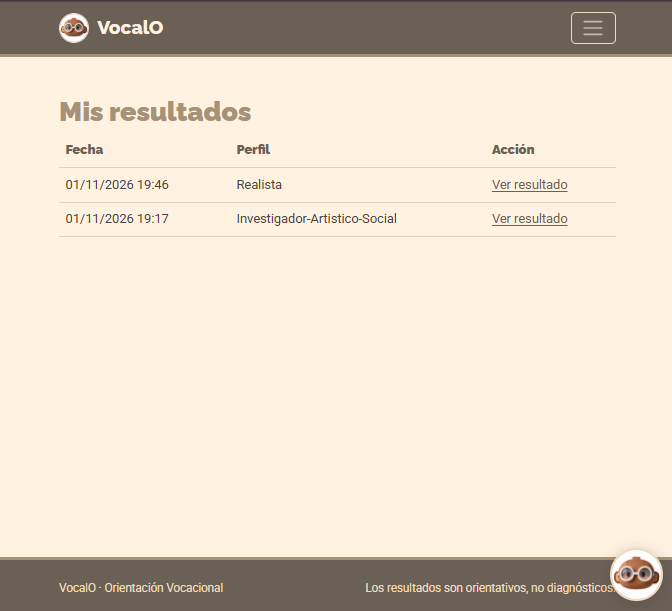

### 3.4 Preguntas frecuentes (sin IA)
La burbuja flotante de **Saviox** (disponible en todas las pantallas, incluso sin sesión) ofrece preguntas frecuentes y también puedes escribir tu duda (máx. 500 caracteres). Responde con un banco de preguntas y palabras clave; **no es inteligencia artificial**. Si no encuentra respuesta te sugiere reformular o usar el Asistente.

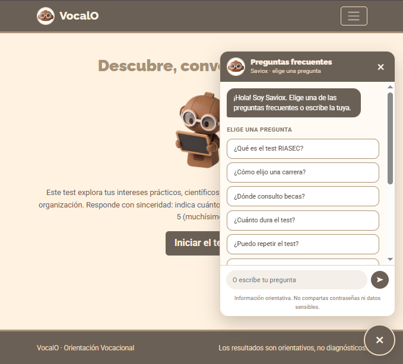

### 3.5 Asistente con IA
1. Completa antes el test (el Asistente se basa en tu **último resultado**).
2. Menú **Asistente**. Escribe tu pregunta (máx. 500 caracteres) y pulsa **Enviar pregunta**.
3. Saviox responde en español, en pocas líneas, usando tu perfil y tus carreras recomendadas. Recuerda hasta **6 mensajes** de la conversación para que puedas hacer preguntas de seguimiento.
4. Ejemplos: "¿Por qué mi perfil encaja con la primera carrera?", "¿Qué habilidades necesito para esa carrera?", "¿Cómo comparo las tres opciones?".
5. Límites: solo habla de orientación vocacional y estudios superiores en El Salvador, no inventa carreras fuera de tu lista, no garantiza admisión ni empleo y no hace diagnósticos psicológicos.
6. Mensajes que puedes ver: *"Todavía no tengo tus resultados…"* (haz el test primero), *"El chat con inteligencia artificial todavía no está configurado…"* (el administrador debe configurar la clave) o *"Tuve un problema para conectarme…"* (reintenta más tarde).

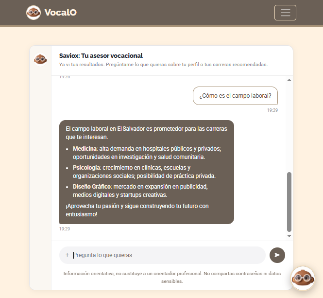

## 4. Administrador

El administrador gestiona los catálogos desde el menú (no realiza el test). Todas las bajas son **lógicas**: el registro se desactiva y se conserva el historial.

| Módulo | Qué se puede hacer |
|---|---|
| **Usuarios** | Crear, editar (nombre, correo, rol, institución, nueva contraseña) y activar/desactivar. No puedes desactivar ni cambiar el rol de **tu propia** cuenta |
| **Preguntas** | Crear, editar (enunciado, área RIASEC, estado) y activar/desactivar. Solo las preguntas activas aparecen en el test |
| **Carreras** | Crear, editar (nombre, descripción, tipo, institución, **áreas RIASEC** que determinan la afinidad) y activar/desactivar. Solo las activas se recomiendan |
| **Instituciones** | Crear, editar y desactivar |
| **Estadísticas** | Estudiantes activos, resultados generados y distribución por perfil |

Los formularios validan los datos y muestran los errores junto al campo. Mantén la contraseña de administrador en secreto.

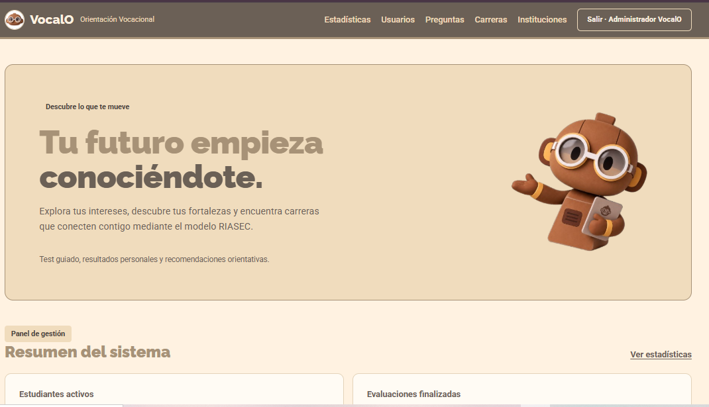
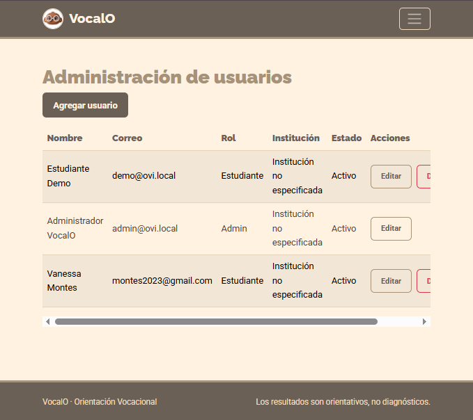
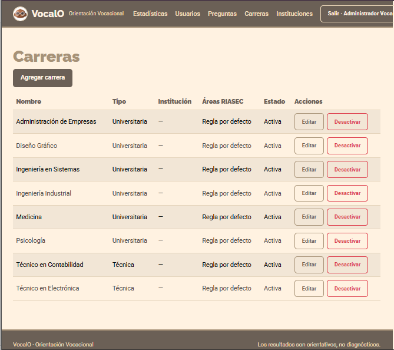
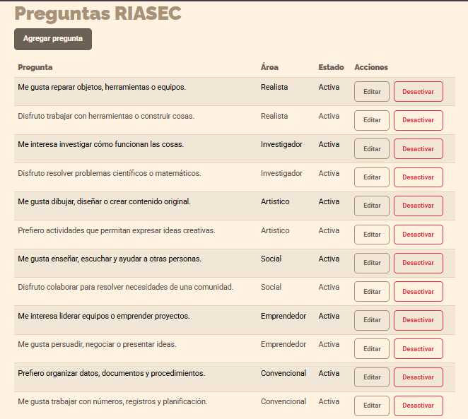
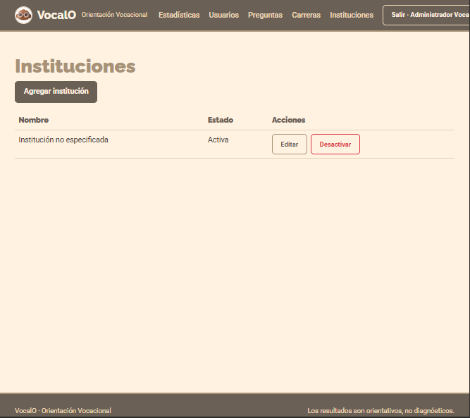
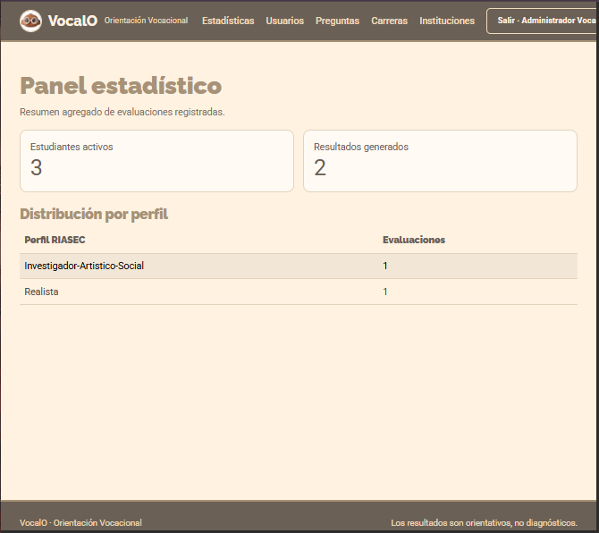

## 5. Interpretación de resultados

El test es una herramienta de exploración de 12 afirmaciones. Para elegir carrera compara además requisitos, costos, plan de estudios y oportunidades, y consulta a profesionales de orientación.

## 6. Preguntas comunes

- **No puedo iniciar sesión:** revisa correo y contraseña; tu cuenta podría estar desactivada.
- **El Asistente no responde:** realiza el test primero o consulta al administrador si la IA está configurada.
- **Quiero cambiar mis respuestas:** repite el test; el historial conserva todos los intentos.
