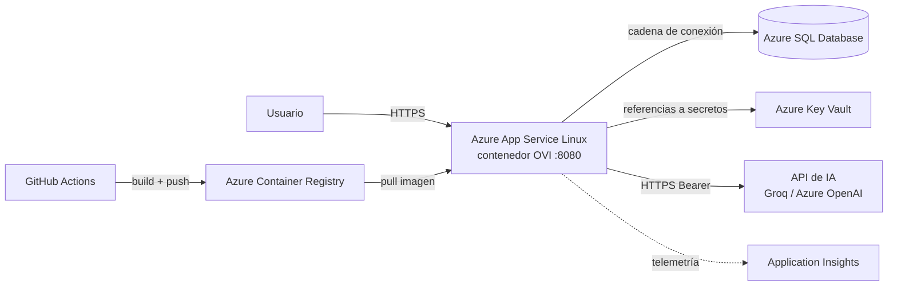

# Propuesta de despliegue en Microsoft Azure

## 1. Servicio Azure seleccionado

**Azure App Service para contenedores (Linux)** ejecutando la imagen Docker de OVI, con **Azure SQL Database** como base de datos.

| Componente | Servicio | Rol |
|---|---|---|
| Aplicación | App Service (plan Linux **B1**) con contenedor | Ejecuta la imagen de `docker/Dockerfile` en el puerto 8080 |
| Imágenes | Azure Container Registry (**Basic**) | Almacena la imagen versionada |
| Datos | Azure SQL Database (**Basic**, 5 DTU) | Reemplaza el SQL Server del `docker-compose` |
| Secretos | Azure Key Vault | `ChatbotIA__ApiKey`, cadena de conexión |
| Observabilidad | Application Insights | Logs, métricas y alertas |
| IA | API *Chat Completions* (Groq actual) o **Azure OpenAI** si hay acceso aprobado | El código solo requiere endpoint HTTPS + modelo + clave |
| CI/CD | GitHub Actions | Ya existe `.github/workflows/main_ovi-orientacion-vocacional.yml` |

**¿Por qué App Service?** Es el camino más corto desde una app ASP.NET Core ya contenerizada: sin administrar servidores ni orquestadores, con HTTPS, escalado y despliegue continuo integrados. Alternativas valoradas: *Azure Container Apps* (más flexible y escala a cero, más configuración) y *AKS* (excesivo para este tamaño).

## 2. Arquitectura de despliegue

Configuración en *App Settings* (equivalentes a `.env`): `ConnectionStrings__OVIConnection`, `OVI_APPLY_MIGRATIONS=true` (solo el primer despliegue o con migraciones controladas), `ChatbotIA__Endpoint`, `ChatbotIA__Modelo`, `ChatbotIA__ApiKey` (referencia a Key Vault), `OVI_ADMIN_EMAIL`, `OVI_ADMIN_PASSWORD`, `WEBSITES_PORT=8080`. Health check del App Service: `/health`.

## 3. Beneficios

- **Portabilidad:** la misma imagen Docker probada localmente es la que corre en la nube.
- **Administrado:** parches del SO, TLS/HTTPS, balanceo y reinicio automático incluidos.
- **Escalable:** escalado vertical (cambio de plan) y horizontal (más instancias) sin cambiar código.
- **Seguridad:** secretos en Key Vault, identidad administrada, base con firewall y copias de seguridad automáticas.
- **Operación:** Application Insights y alertas; despliegue continuo desde GitHub.

## 4. Costos aproximados (USD/mes, región de EE. UU., pago por uso)

| Recurso | Configuración | Estimado |
|---|---|---|
| App Service plan Linux | B1 (1 núcleo, 1.75 GB RAM) | ≈ 13 |
| Azure SQL Database | Basic, 5 DTU, 2 GB | ≈ 5 |
| Azure Container Registry | Basic | ≈ 5 |
| Key Vault | Operaciones de secretos | < 1 |
| Application Insights | Primeros ~5 GB/mes de datos gratuitos | 0 – 2 |
| IA (Groq / Azure OpenAI) | Pago por tokens; uso académico bajo | variable (centavos a pocos dólares) |
| **Total estimado** | | **≈ 23 – 26 USD/mes + IA** |

Opciones para reducir costo en la demostración: plan **Free F1** de App Service (límites de CPU y sin *Always On*) y créditos de estudiante de Azure (p. ej. *Azure for Students*). Un tráfico mayor requeriría subir de plan o a Azure SQL de más DTU (≈ 15 USD/mes para S0 de 10 DTU).

## 5. Pasos de implementación propuestos

1. Crear grupo de recursos, Azure Container Registry y plan/App Service Linux para contenedores.
2. Construir y publicar la imagen: `az acr build -r <acr> -t ovi:latest -f docker/Dockerfile .`
3. Provisionar Azure SQL Database y permitir el acceso desde el App Service; guardar la cadena de conexión en Key Vault.
4. Configurar las *App Settings* anteriores y HTTPS obligatorio; aplicar migraciones una vez (`OVI_APPLY_MIGRATIONS=true` o `dotnet ef database update`).
5. Habilitar Application Insights, alertas y copia de seguridad; validar registro, test, CRUD y Asistente con IA.
6. Automatizar con GitHub Actions (build de imagen → ACR → despliegue al App Service).

## 6. Estado actual en el repositorio

El workflow existente publica el código con `dotnet publish` en el App Service `ovi-orientacion-vocacional` al hacer *push* a `main` (hoy compila con .NET 8, igual que el proyecto, pero no usa la imagen de ACR). Para alinearlo con esta propuesta se reemplazaría el paso de publicación por la construcción y despliegue de la imagen Docker. No subir `.env`, credenciales ni claves API a Git.
