# Plan de pruebas y evidencias

**No marcar como aprobado hasta ejecutarlo y capturar evidencia real.** Guardar capturas en `docs/evidencias/` y anotar fecha, responsable, resultado esperado y observado.

**Responsable del Plan:** Roberto Portillo
**Fecha de Ejecución:** 21/10/2026

| ID | Caso | Resultado esperado | Resultado observado | Evidencia | Estado |
|---|---|---|---|---|---|
| P01 | Registro de estudiante nuevo | Cuenta creada con rol Estudiante | Cuenta creada con éxito e inicio de sesión automático | 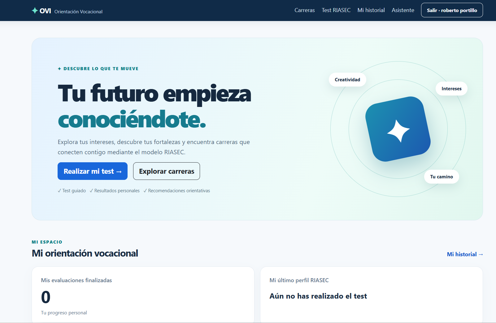 | **Aprobado** |
| P02 | Login con contraseña incorrecta | Rechazo sin iniciar sesión | Muestra alerta de credenciales inválidas y bloquea el acceso | 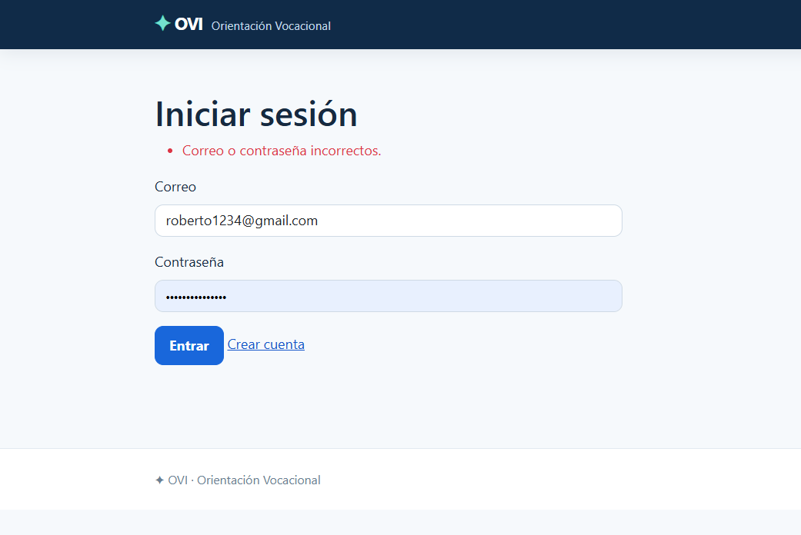 | **Aprobado** |
| P03 | Login correcto y cierre de sesión | Acceso y cierre de sesión | Sesión iniciada correctamente y cierre de sesión exitoso | 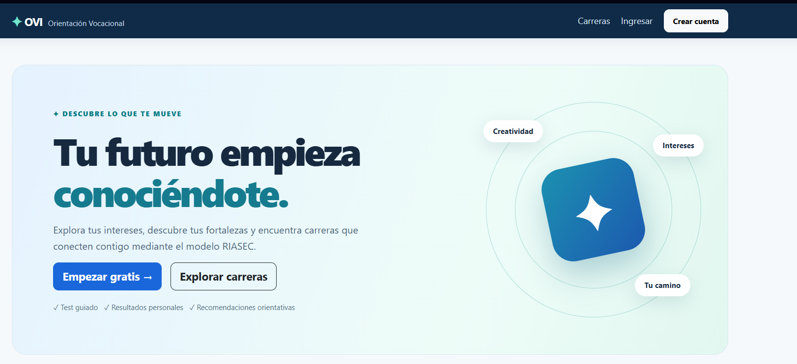 | **Aprobado** |
| P04 | Estudiante intenta entrar a `/Usuarios` | Acceso denegado | Redirección a `/Cuenta/Denegado` con mensaje de acceso restringido por rol | 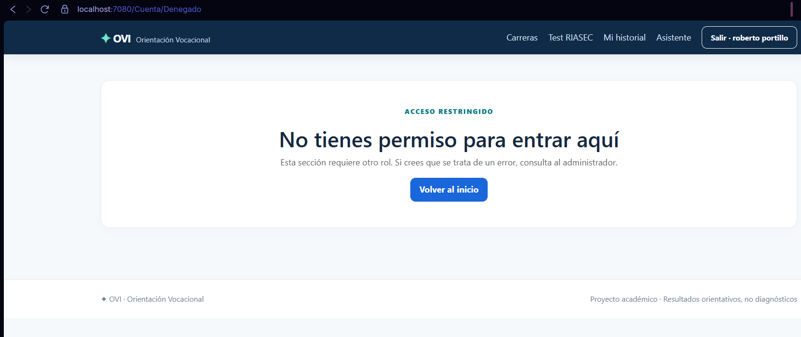 | **Aprobado** |
| P05 | Estudiante ve inicio | Solo métricas personales | Visualización exclusiva del panel personal del estudiante con progreso de tests | 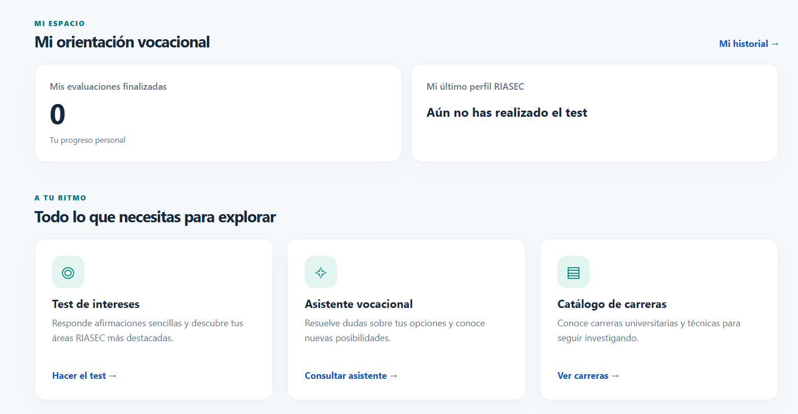 | **Aprobado** |
| P06 | Admin ve inicio y CRUD | Métricas globales y controles CRUD | Dashboard administrativo visible con panel de gestión de métricas globales (estudiantes, evaluaciones, catálogo) | 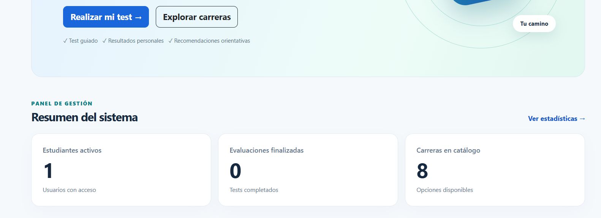 | **Aprobado** |
| P07 | Crear, editar y eliminar carrera | Registro y cambios reflejados | Formulario de creación de carrera ejecutado y cambios guardados correctamente en la BD | 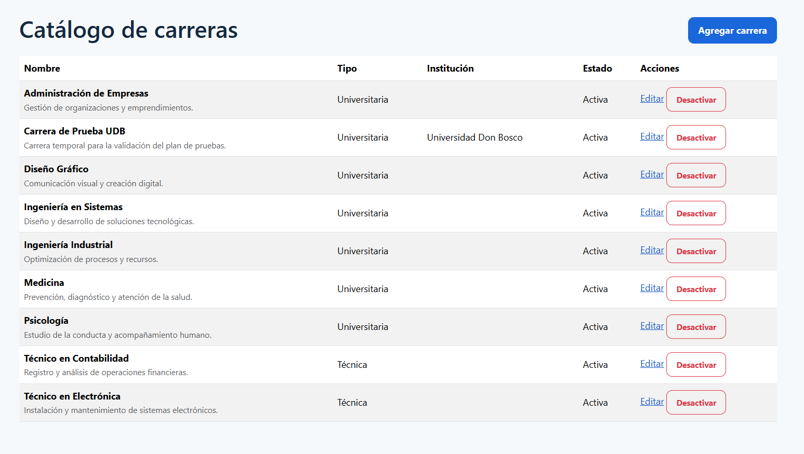 | **Aprobado** |
| P08 | Iniciar Test RIASEC | Carga del cuestionario | Carga correcta de las preguntas del test RIASEC y escala de valoración (1 a 5) | 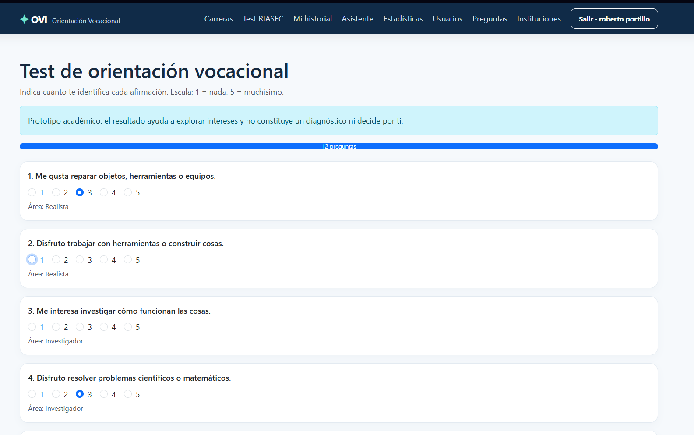 | **Aprobado** |
| P09 | Completar Test y guardar resultado | Cálculo del perfil RIASEC | Cálculo exitoso del perfil (Investigador-Convencional), desglose por áreas y recomendaciones de carreras | 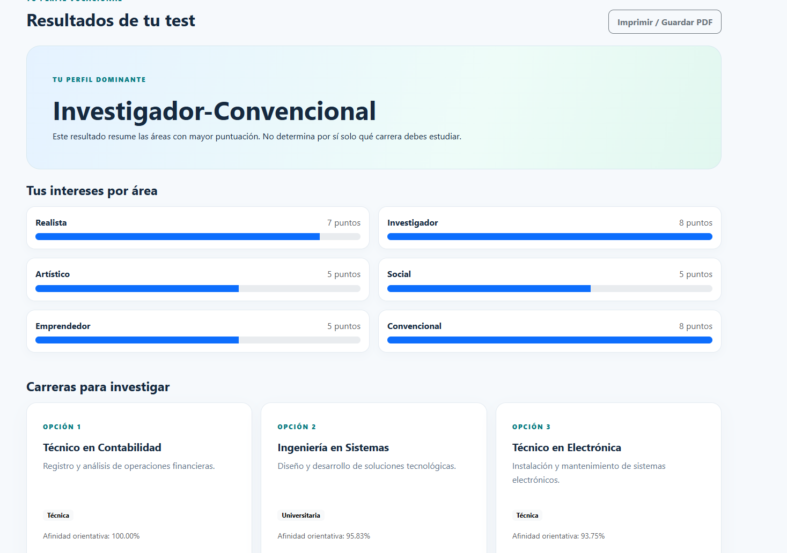 | **Aprobado** |
| P10 | Usuario A intenta ver resultado de B | Acceso denegado | Redirección exitosa a `/Cuenta/Denegado` impidiendo visualizar la evaluación de otro usuario | 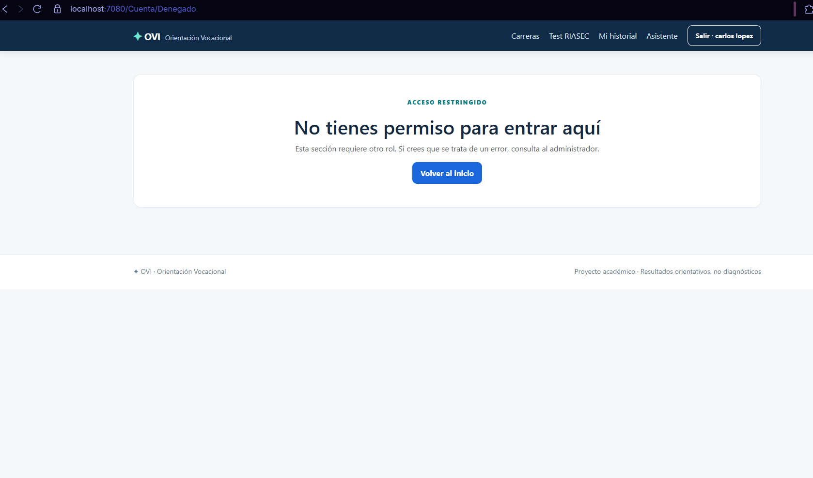 | **Aprobado** |
| P11 | Chat FAQ sin clave | Respuesta marcada como FAQ, no IA | Consulta realizada en el Asistente vocacional sin clave de IA; el sistema responde utilizando el catálogo local de preguntas frecuentes (FAQ) | 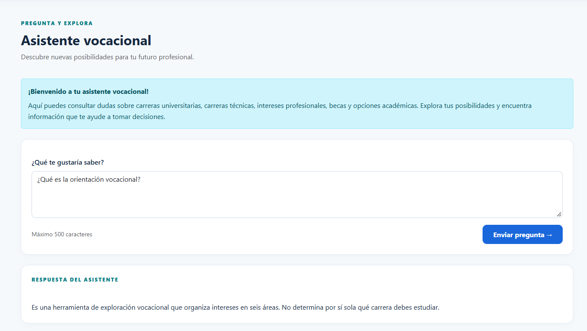 | **Aprobado** |
| P12 | Chat con proveedor IA configurado | Respuesta generada por IA con flujo detallado | Consulta procesada y respondida exitosamente mediante respuesta contextualizada de IA para la carrera de Ingeniería en Sistemas | 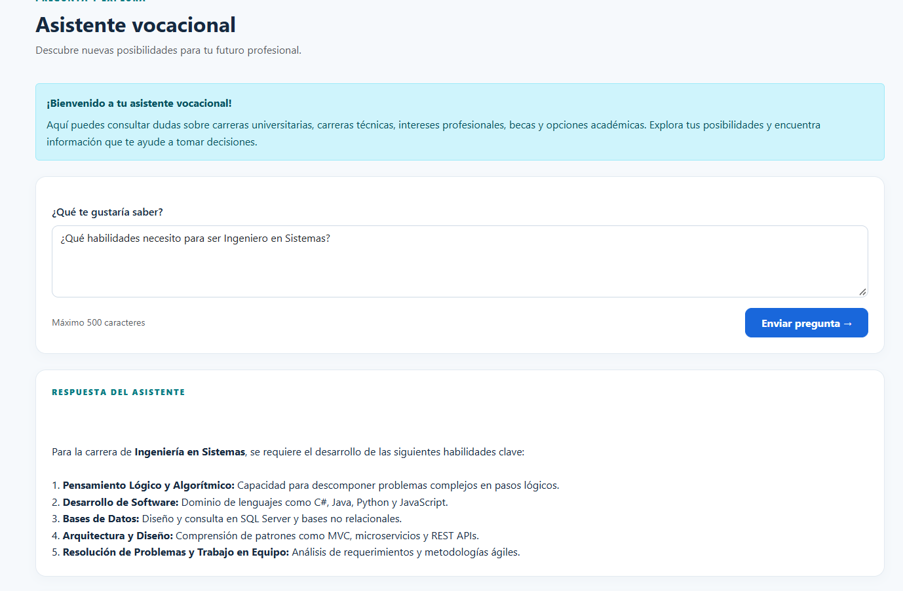 | **Aprobado** |
| P13 | Docker web y SQL | `docker compose ps` ambos en marcha; web accesible en 8080 | Verificación del despliegue exitoso de contenedores de aplicación ASP.NET Core (puerto 8080) y SQL Server 2022 (healthy) en Docker | 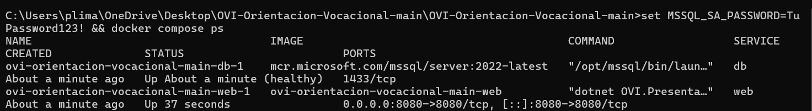 | **Aprobado** |
| P14 | Persistencia Docker | Reiniciar contenedores, datos permanecen | Verificación de permanencia de datos al reiniciar los contenedores mediante el volumen mapeado `ovi_sql_data` | 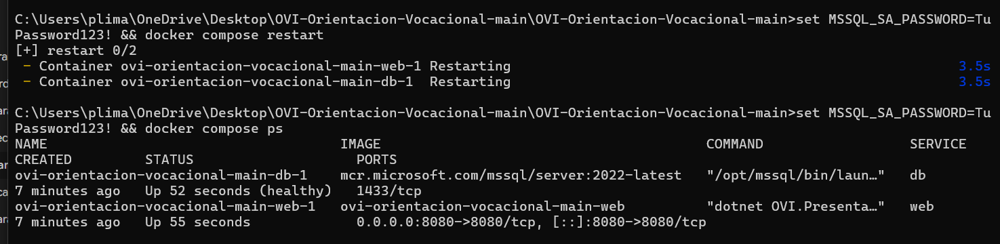 | **Aprobado** |
| P15 | Impresión resultado | PDF guardado desde navegador | Generación y exportación exitosa del informe de resultados vocacionales en formato PDF mediante el menú de impresión del navegador | 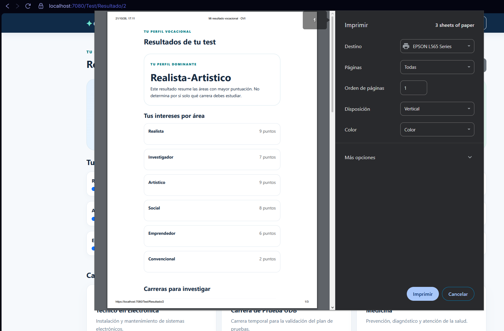 | **Aprobado** |
Consulta SQL de apoyo:
```sql
USE OrientacionVocacionalDB;
SELECT COUNT(*) AS Usuarios FROM dbo.Usuarios;
SELECT COUNT(*) AS Evaluaciones FROM dbo.Evaluaciones;
SELECT TOP (5) PerfilDominante, FechaResultado FROM dbo.Resultados ORDER BY FechaResultado DESC;
```
