# Plan de pruebas y evidencias

Cubre lo que exige la guía de la Fase II: funcionamiento del sistema, ejecución de casos de uso, funcionamiento de la IA y ejecución dentro de Docker. Las capturas se guardan en `docs/evidencias/` con el nombre indicado (lista completa en [evidencias/README.md](evidencias/README.md)).

**Responsable del plan:** Roberto Portillo · **Participantes:** _[Completar]_
**Entornos:** (A) local con SQL Server Express · (B) Docker Compose (`http://localhost:8080`)
**Estados:** **Aprobado** = ejecutado con la versión actual (31/10/2026) y con evidencia · **Re-ejecutar** = captura del 21/10/2026, anterior a los últimos cambios; conviene repetirla.

> No marcar **Aprobado** sin haber ejecutado el caso con la versión actual y guardado la captura real. Sin contraseñas ni claves API visibles.

## A. Casos de uso funcionales

| ID | Caso | Resultado esperado | Resultado observado | Evidencia | Estado |
|---|---|---|---|---|---|
| P01 | Registro de estudiante nuevo | Cuenta con rol Estudiante e inicio de sesión | Cuenta creada e inicio de sesión automático (31/10) | 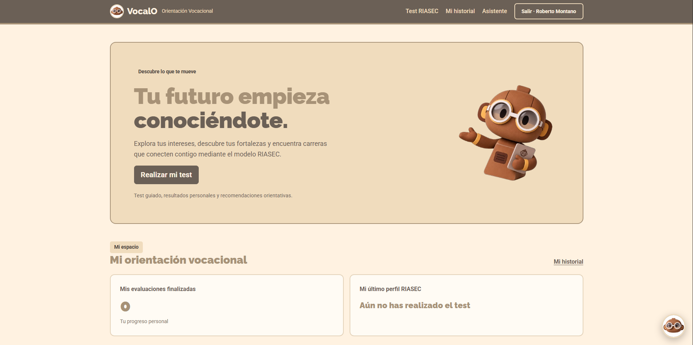 | Aprobado |
| P02 | Login con contraseña incorrecta | Rechazo sin iniciar sesión | Alerta "Correo o contraseña incorrectos" (31/10) | 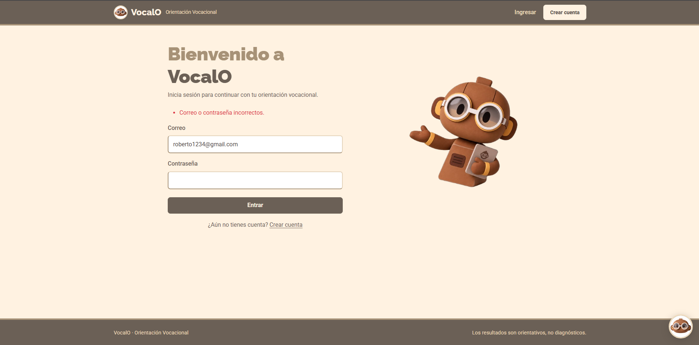 | Aprobado |
| P03 | Cierre de sesión | Sesión cerrada | Barra con Ingresar / Crear cuenta (31/10) | 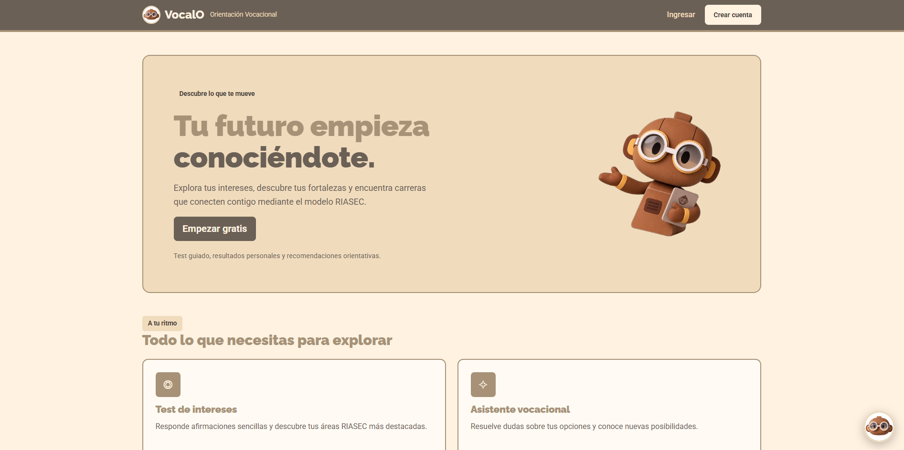 | Aprobado |
| P04 | Estudiante intenta entrar a `/Usuarios` | Acceso denegado | Redirección a `/Cuenta/Denegado` con "No tienes permiso para entrar aquí" (31/10) | 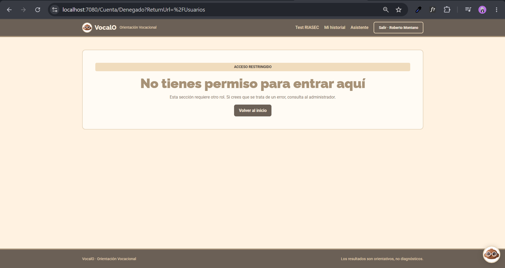 | Aprobado |
| P05 | Estudiante ve inicio | Solo métricas personales | Panel personal con "Mis evaluaciones finalizadas" y último perfil (31/10) | 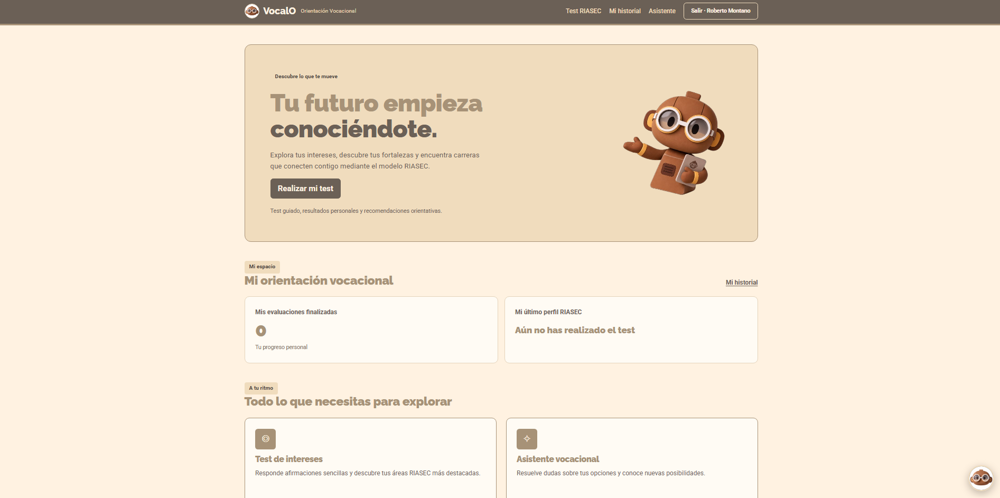 | Aprobado |
| P06 | Admin ve inicio | Métricas globales y menú de administración | Resumen del sistema y menú Estadísticas, Usuarios, Preguntas, Carreras, Instituciones (31/10) | 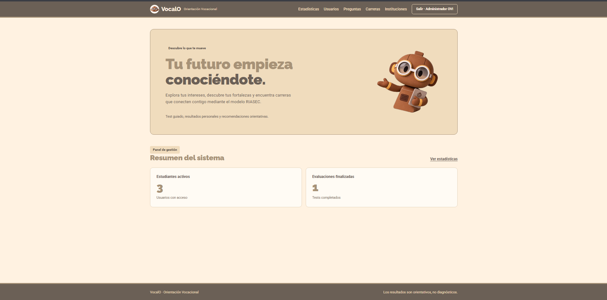 | Aprobado |
| P07 | Iniciar Test RIASEC | Una pregunta por paso con escala 1–5 | "Pregunta 1 de 12" con opciones de 1 a 5 y barra de progreso (31/10) | 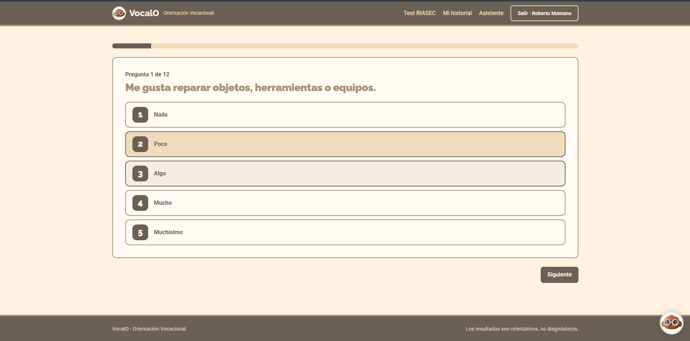 | Aprobado |
| P08 | Completar el test y guardar resultado | Perfil, puntajes por área y 3 carreras con % de afinidad | Perfil Social; Medicina, Psicología y Lic. en Ciencias Ambientales y Sostenibilidad con 75 % (31/10) | 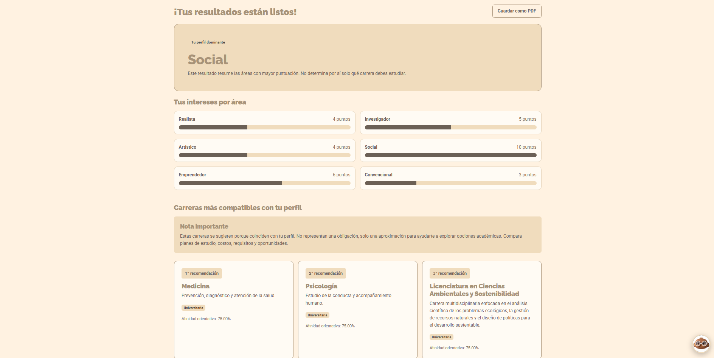 | Aprobado |
| P09 | Usuario intenta ver un resultado ajeno | Acceso denegado | "No tienes permiso para entrar aquí" (31/10) | 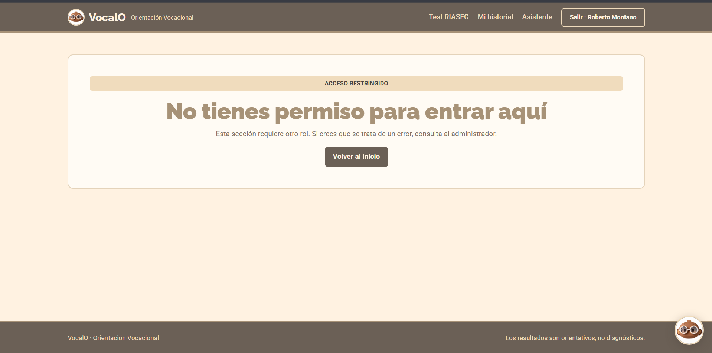 | Aprobado |
| P10 | Guardar resultado como PDF | PDF generado desde el navegador | `VocalO-resultado.pdf` descargado (31/10) | 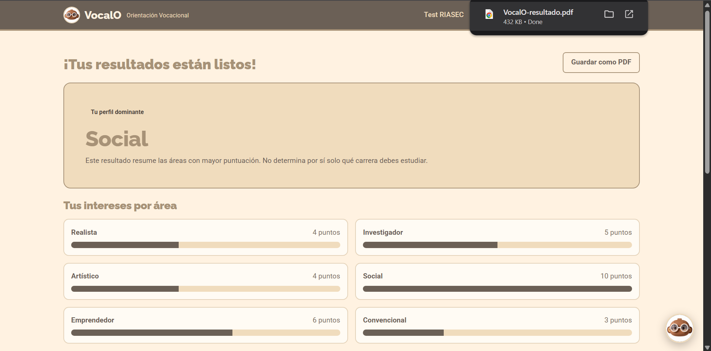 | Aprobado |
| P11 | Admin · Carreras: crear con áreas RIASEC | La carrera nueva aparece en la lista | Mensaje "Carrera creada correctamente"; la carrera aparece con áreas Investigador, Social (31/10) | 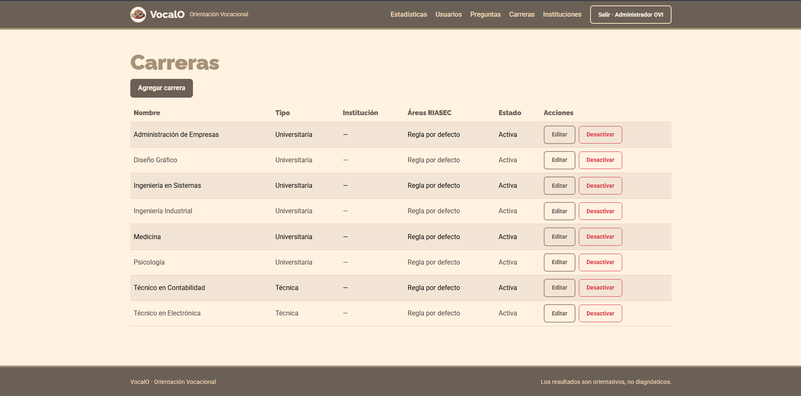 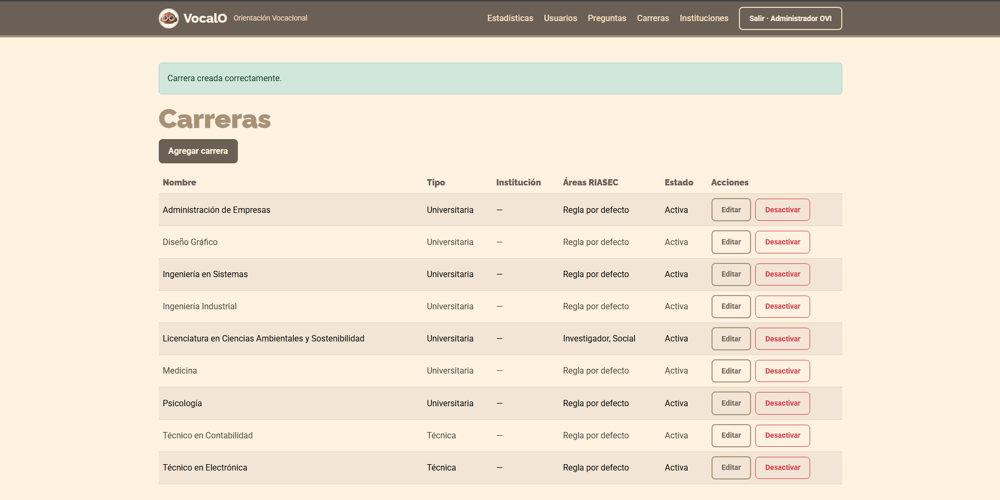 | Aprobado |
| P12 | Admin · Carreras: desactivar | La carrera queda inactiva y se puede reactivar | Mensaje "Carrera desactivada"; estado Inactiva con botón Activar (31/10) | 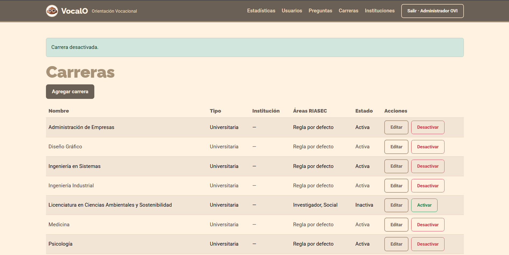 | Aprobado |
| P13 | Admin · Usuarios: desactivar | El usuario queda inactivo y se puede reactivar | Mensaje "Usuario desactivado"; estado Inactivo con botón Activar (31/10) | 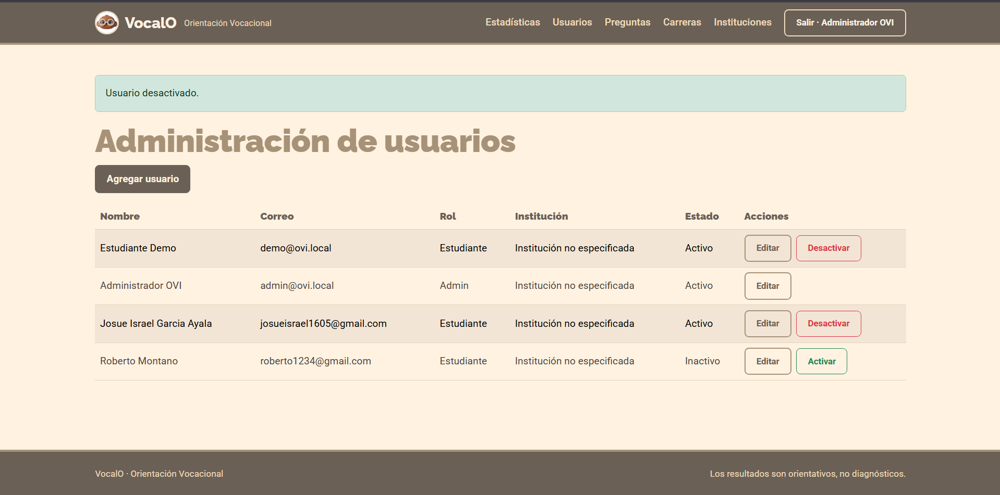 | Aprobado |
| P14 | Usuario desactivado intenta iniciar sesión | Acceso bloqueado | Alerta "Correo o contraseña incorrectos" (31/10) | 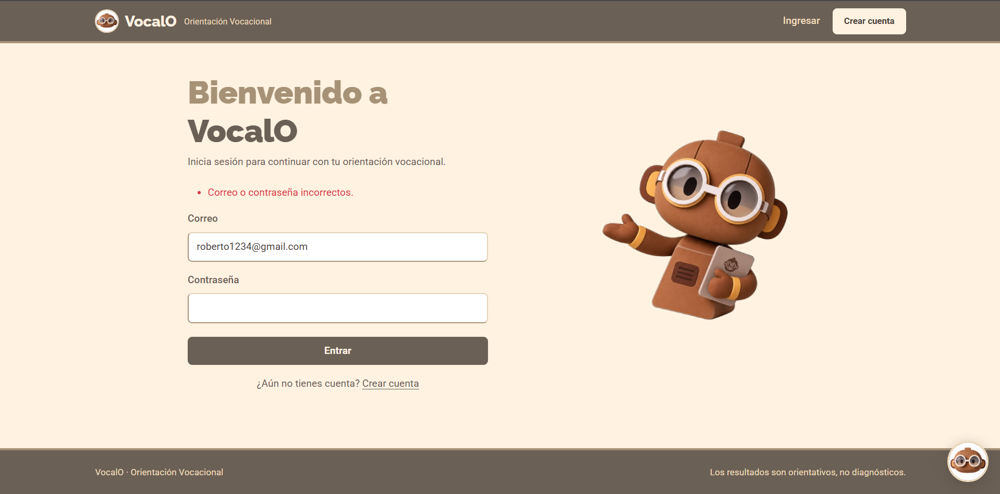 | Aprobado |
| P15 | Estadísticas (Admin) | Totales y distribución por perfil | 3 estudiantes activos, 3 resultados; Social 2, Emprendedor-Convencional 1 (31/10) | 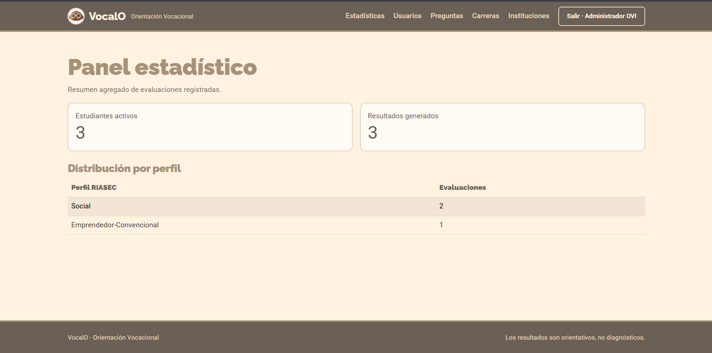 | Aprobado |

## B. Inteligencia artificial

| ID | Caso | Resultado esperado | Resultado observado | Evidencia | Estado |
|---|---|---|---|---|---|
| P16 | Burbuja de Preguntas frecuentes (sin sesión) | Respuesta del banco FAQ, no IA | Respuesta a "¿Qué es el test RIASEC?" (31/10) | 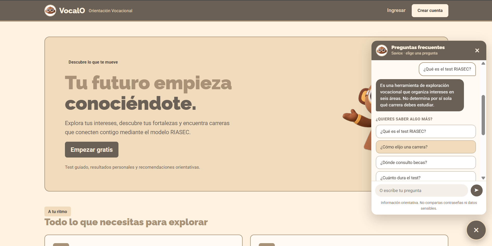 | Aprobado |
| P17 | Asistente con sesión pero sin test realizado | Pide completar el test | "Aún no encuentro resultados de un test tuyo…" y chat deshabilitado (31/10) | 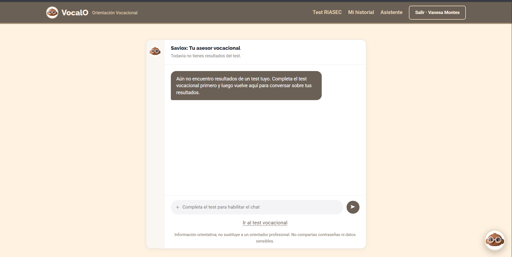 | Aprobado |
| P18 | Asistente sin `ApiKey` | Avisa que la IA no está configurada | "El chat con inteligencia artificial todavía no está configurado…" (31/10) | 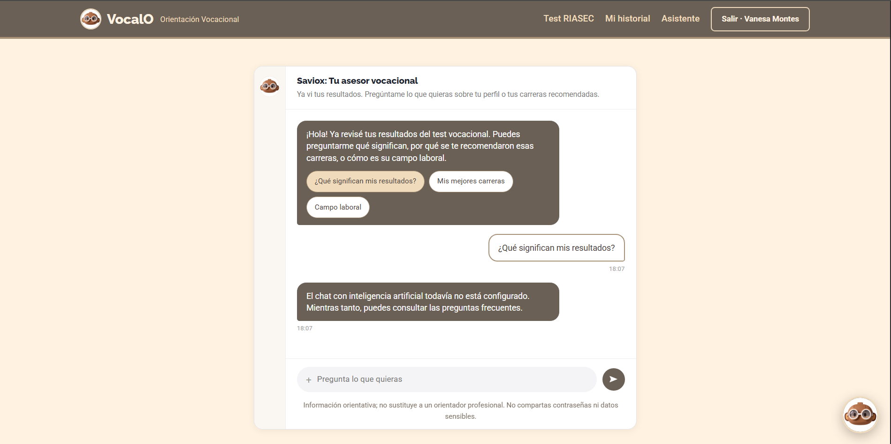 | Aprobado |
| P19 | **Asistente con IA configurada** — entrada: perfil + 3 carreras + pregunta; salida: respuesta contextual | Respuesta que menciona el perfil y las carreras reales del usuario | Perfil Investigador-Social-Convencional y 3 carreras recomendadas (31/10) | 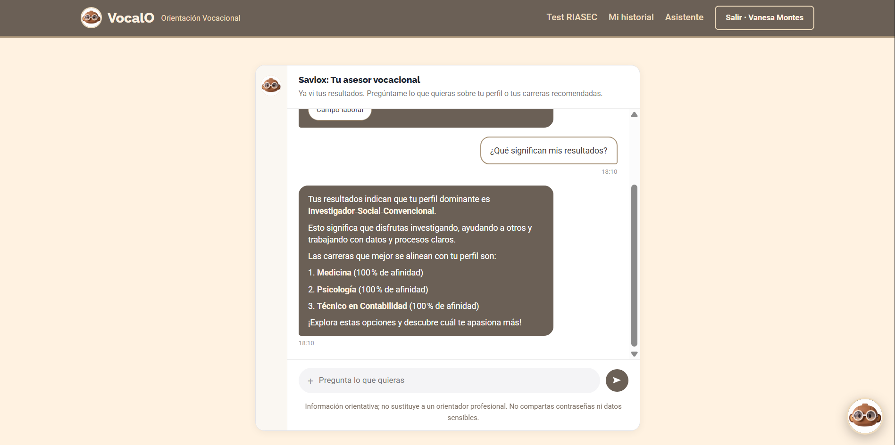 | Aprobado |

## C. Docker

| ID | Caso | Resultado esperado | Resultado observado | Evidencia | Estado |
|---|---|---|---|---|---|
| P20 | `docker compose up --build -d` y `docker compose ps` | `web` y `db` en marcha (`db` healthy); web en 8080 | Contenedores en ejecución (21/10) | 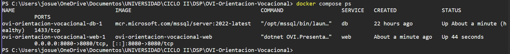 | Re-ejecutar |
| P21 | Persistencia: `docker compose restart` y consultar | Los datos permanecen (volumen `ovi_sql_data`) | Datos conservados (21/10) | 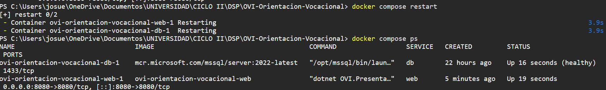 | Re-ejecutar |

## Resumen de resultados

| Bloque | Casos | Aprobados | Re-ejecutar |
|---|---|---|---|
| A. Casos de uso | 15 | 15 | 0 |
| B. IA | 4 | 4 | 0 |
| C. Docker | 2 | 0 | 2 |
| **Total** | **21** | **19** | **2** |
